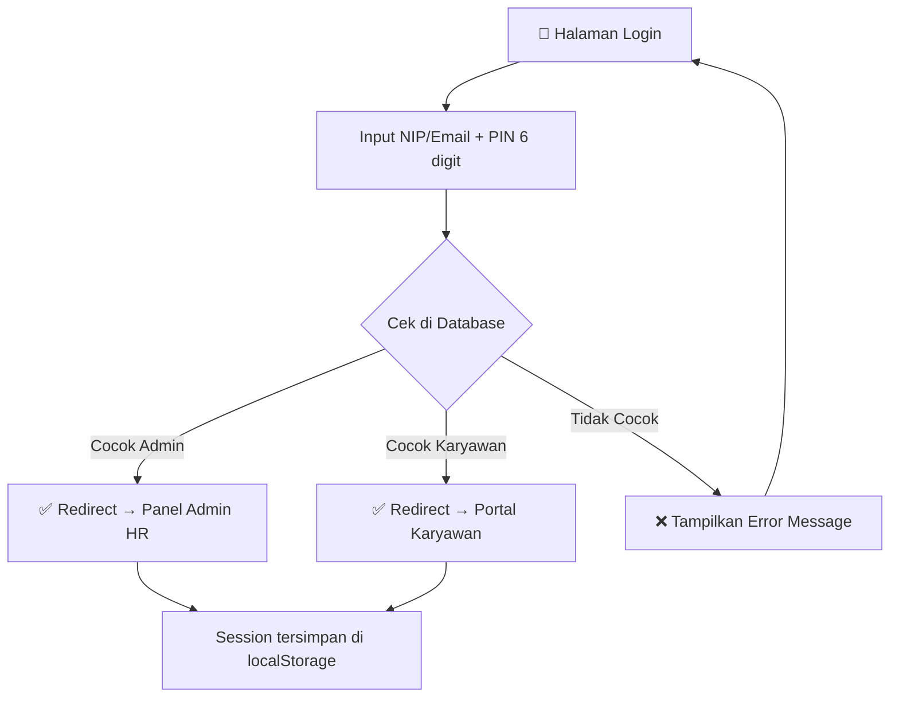
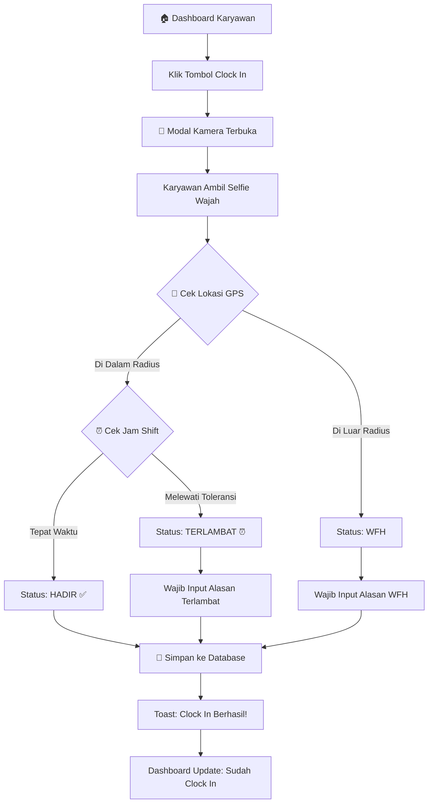
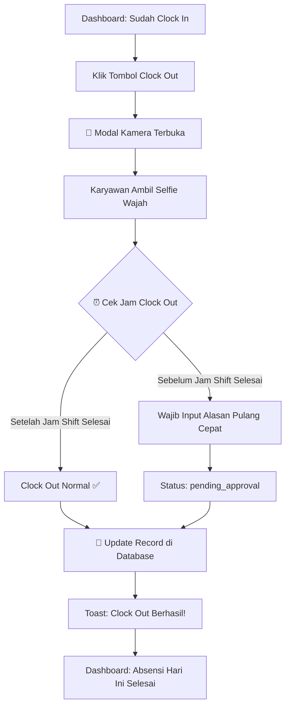
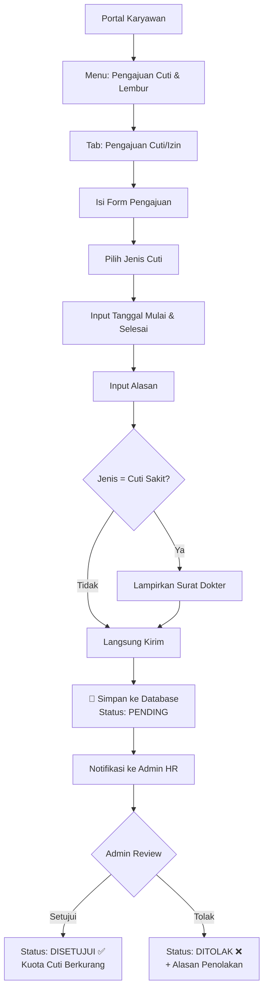
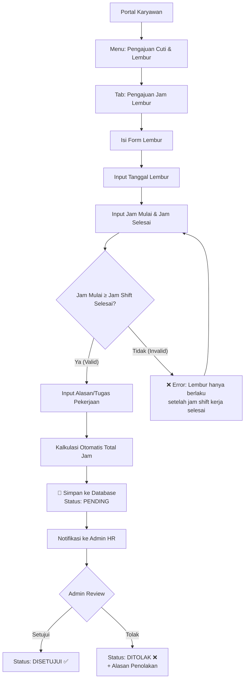
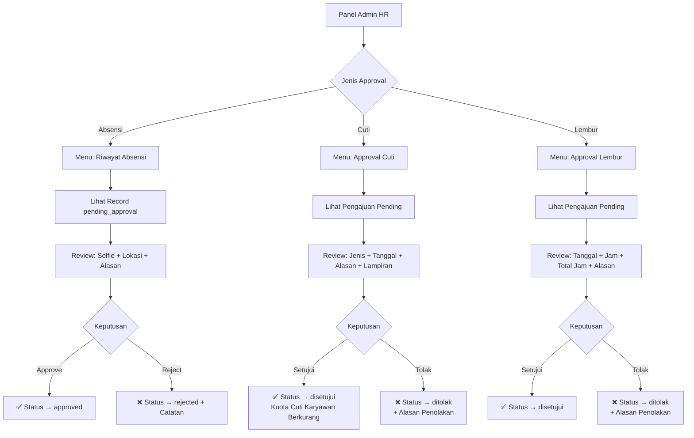
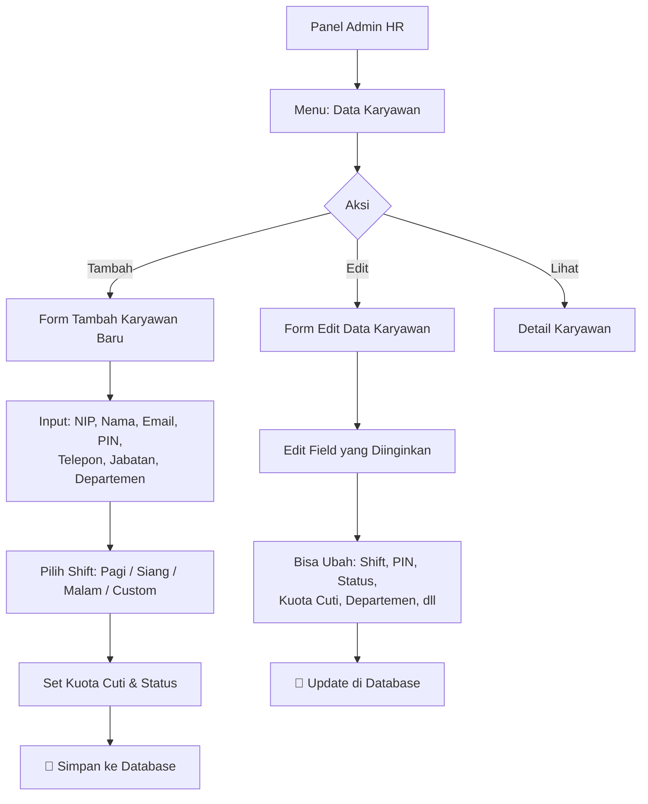
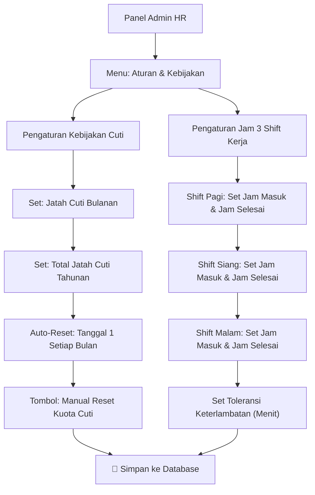
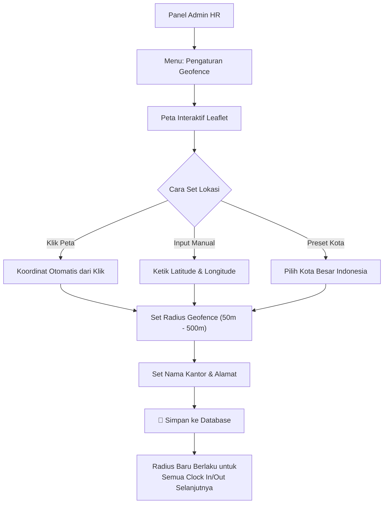
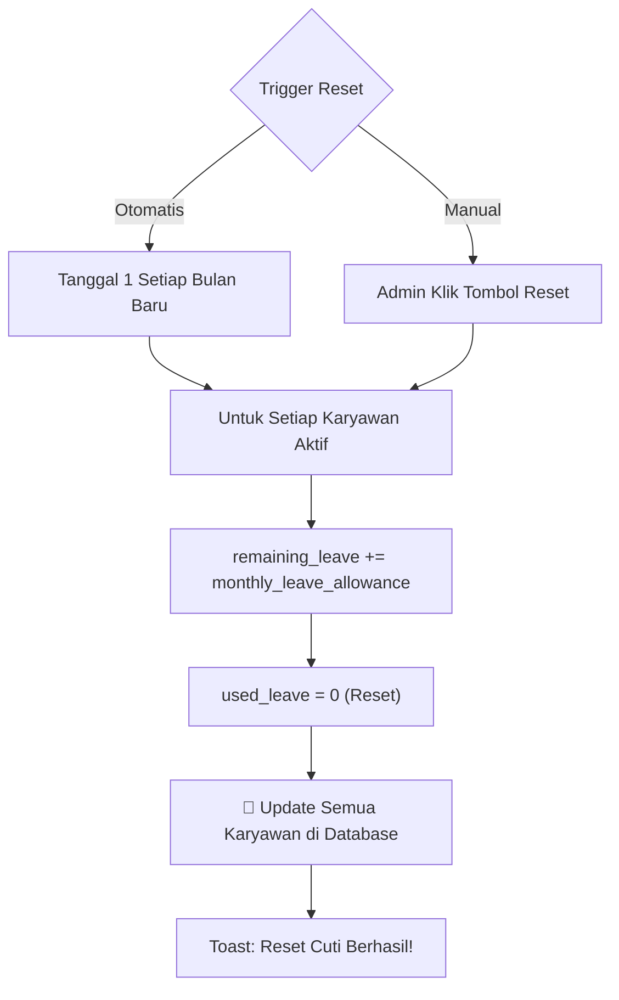

# 🔄 Alur Bisnis — Sistem Absensi Karyawan

**Versi Dokumen:** 1.0  
**Tanggal:** 31 Agustus 2026

---

## 1. Alur Login (Autentikasi)

**Detail Alur:**
1. Pengguna membuka aplikasi → Halaman Login ditampilkan.
2. Pengguna memasukkan **NIP/Email** dan **PIN 6 digit**.
3. Sistem cek ke tabel `admins` terlebih dahulu:
   - Jika cocok → login sebagai **Admin HR**.
4. Jika bukan admin, cek ke tabel `employees`:
   - Jika cocok → login sebagai **Karyawan** (set `activeEmployeeId`).
5. Jika tidak ditemukan di kedua tabel → tampilkan pesan error.
6. Session disimpan di `localStorage` → persist saat refresh halaman.

---

## 2. Alur Clock In (Absen Masuk)

**Detail Alur:**
1. Karyawan membuka Dashboard → Tekan tombol **Clock In**.
2. Modal kamera terbuka → Karyawan mengambil **selfie wajah**.
3. Sistem otomatis membaca **koordinat GPS perangkat**.
4. **Hitung jarak** ke koordinat kantor (rumus Haversine).
5. **Tentukan status:**

| Kondisi | Status | Approval |
|---|---|---|
| Di dalam radius + tepat waktu | `hadir` | `approved` otomatis |
| Di dalam radius + lewat toleransi | `terlambat` | `pending_approval` → perlu approval Admin |
| Di luar radius kantor | `wfh` | `approved` (alasan wajib diisi) |

6. Data disimpan ke tabel `attendance_records` di MySQL.
7. Dashboard karyawan menampilkan status absensi hari ini.

---

## 3. Alur Clock Out (Absen Pulang)

**Detail Alur:**
1. Karyawan yang sudah Clock In → Tekan tombol **Clock Out**.
2. Modal kamera terbuka → Ambil selfie wajah.
3. **Cek jam Clock Out** terhadap jam shift selesai karyawan:
   - Jika **setelah jam shift selesai** → Clock Out normal, `approved`.
   - Jika **sebelum jam shift selesai** → Wajib input alasan + status `pending_approval`.
4. Record `attendance_records` di-update dengan `clock_out_time`, lokasi, dan selfie.

---

## 4. Alur Pengajuan Cuti / Izin

**Jenis Cuti yang Tersedia:**

| Jenis Cuti | Lampiran Wajib? |
|---|---|
| Cuti Tahunan | Tidak |
| Cuti Sakit | Ya (Surat Keterangan Dokter) |
| Cuti Melahirkan | Ya |
| Cuti Alasan Penting | Tidak |
| Izin Khusus | Tidak |

**Dampak Approval Cuti:**
- Saat Admin menyetujui → `remaining_leave` karyawan **otomatis berkurang** sesuai jumlah hari.
- Saat Admin menolak → kuota cuti **tidak berubah**.

---

## 5. Alur Pengajuan Jam Lembur

**Aturan Validasi Lembur:**

| Shift Karyawan | Jam Selesai Shift | Lembur Valid Mulai |
|---|---|---|
| Shift Pagi (08:00 - 17:00) | 17:00 | ≥ 17:00 |
| Shift Siang (13:00 - 21:00) | 21:00 | ≥ 21:00 |
| Shift Malam (21:00 - 05:00) | 05:00 | ≥ 05:00 |

---

## 6. Alur Approval Admin HR

---

## 7. Alur Manajemen Karyawan (Admin)

---

## 8. Alur Pengaturan Shift & Kebijakan

**Dampak Pengaturan Shift:**
- Jam shift yang diubah di sini **otomatis berlaku** untuk penugasan karyawan baru.
- Karyawan yang sudah dipasangkan shift → shift string di record-nya tetap menggunakan jam yang tertulis di field `shift`.
- Toleransi keterlambatan diterapkan saat kalkulasi status Clock In.

---

## 9. Alur Pengaturan Geofence

---

## 10. Alur Reset Kuota Cuti Bulanan

---

## 11. Ringkasan Status & Transisi

### Status Kehadiran (Attendance)

| Status | Kode | Deskripsi | Butuh Approval? |
|---|---|---|---|
| ✅ Hadir | `hadir` | Clock In tepat waktu + di dalam radius | Tidak |
| ⏰ Terlambat | `terlambat` | Clock In melewati toleransi | Ya |
| 🏠 WFH | `wfh` | Clock In di luar radius geofence | Tidak (alasan wajib) |
| 🚗 Dinas Luar | `dinas_luar` | Tugas di luar kantor | Ya |
| 🏖️ Cuti | `cuti` | Izin tidak masuk kerja | Via pengajuan cuti |
| ❌ Alpha | `alpha` | Tidak absen tanpa keterangan | - |

### Status Pengajuan (Cuti & Lembur)

| Status | Kode | Transisi |
|---|---|---|
| ⏳ Pending | `pending` | → Disetujui / Ditolak oleh Admin |
| ✅ Disetujui | `disetujui` | Final (tidak bisa diubah) |
| ❌ Ditolak | `ditolak` | Final + alasan penolakan wajib |

### Status Approval Kehadiran

| Status | Kode | Transisi |
|---|---|---|
| ✅ Approved | `approved` | Absensi valid |
| ⏳ Pending | `pending_approval` | → Approved / Rejected oleh Admin |
| ❌ Rejected | `rejected` | Absensi tidak valid + catatan Admin |
