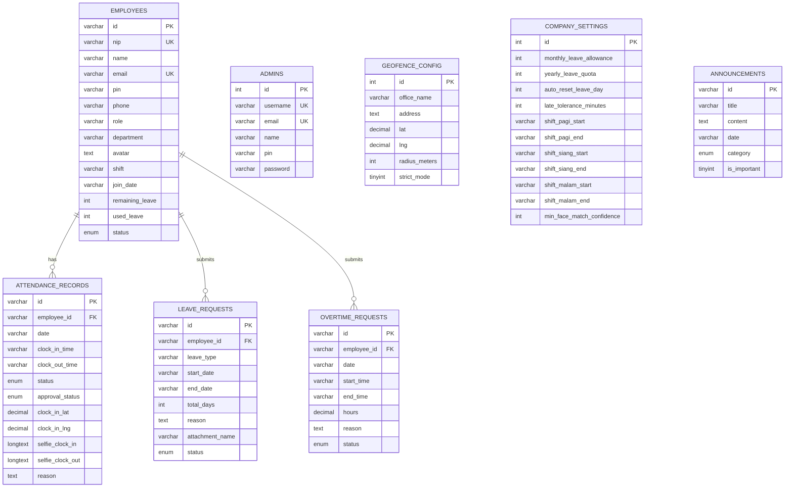

# 📋 PRD — Sistem Absensi Karyawan

**Versi Dokumen:** 1.0  
**Tanggal:** 31 Agustus 2026  
**Status:** ✅ Implementasi Selesai  
**Tim Produk:** Mirwan — Full Stack Developer

---

## 1. Ringkasan Produk (Product Overview)

**Sistem Absensi Karyawan** adalah aplikasi web full-stack untuk mencatat, memantau, dan mengelola kehadiran karyawan secara real-time. Sistem ini mencakup fitur **Clock In/Out berbasis GPS & Selfie Kamera**, **Pengajuan Cuti/Izin**, **Pengajuan Jam Lembur**, serta **Panel Admin HR** untuk verifikasi, approval, dan rekapitulasi data kehadiran perusahaan.

### Tech Stack

| Layer | Teknologi |
|---|---|
| **Frontend** | React 19 + TypeScript + Vite |
| **Styling** | Tailwind CSS 4 + Lucide Icons + Motion (Framer Motion) |
| **Backend API** | Node.js + Express.js (ESM) |
| **Database** | MySQL 8.x (InnoDB, utf8mb4) |
| **Peta Interaktif** | Leaflet.js + OpenStreetMap |
| **Deployment** | Localhost (dev) / Cloud VPS (produksi) |

---

## 2. Tujuan Produk (Product Goals)

1. **Digitalisasi absensi** — Menggantikan absensi manual (kertas/fingerprint) dengan sistem berbasis web yang dapat diakses dari perangkat apapun (HP/Laptop).
2. **Akurasi lokasi** — Memvalidasi posisi karyawan saat absen menggunakan GPS Geofencing (radius kantor).
3. **Pencegahan kecurangan** — Selfie wajah saat Clock In/Out untuk diverifikasi Admin, mencegah titip absen.
4. **Manajemen cuti & lembur terpusat** — Pengajuan, approval, dan tracking cuti/lembur dalam satu platform.
5. **Fleksibilitas shift kerja** — Mendukung 3 shift (Pagi/Siang/Malam) dengan jam yang dapat dikonfigurasi Admin HR.

---

## 3. Peran Pengguna (User Roles)

### 3.1. Karyawan (Employee)

| Atribut | Detail |
|---|---|
| **Login** | NIP / Email + PIN 6 digit |
| **Akses** | Portal Karyawan (Dashboard, Riwayat, Cuti & Lembur, Profil) |
| **Kemampuan** | Clock In/Out, Lihat riwayat absensi, Ajukan cuti, Ajukan lembur, Lihat pengumuman |

### 3.2. Admin HR (Administrator)

| Atribut | Detail |
|---|---|
| **Login** | Username `admin` / Email admin + PIN 6 digit |
| **Akses** | Panel Admin HR (Dashboard, Riwayat Absensi, Approval Cuti, Approval Lembur, Data Karyawan, Geofence, Pengumuman, Pengaturan) |
| **Kemampuan** | Approve/reject absensi, cuti, & lembur; Kelola data karyawan; Atur geofencing, shift, & kebijakan perusahaan |

---

## 4. Fitur & Modul Lengkap

### 4.1. Modul Autentikasi (Login)

> **File:** [LoginPage.tsx](file:///c:/Users/ASUS%20TUF%20GAMING/OneDrive/%E3%83%89%E3%82%AD%E3%83%A5%E3%83%A1%E3%83%B3%E3%83%88/MIRWAN/PROJECT%20WEBSITE/sistem-absensi-karyawan/src/components/auth/LoginPage.tsx)

- **Satu halaman login tunggal** — Karyawan dan Admin masuk dari portal yang sama.
- Input: **NIP / Email** + **PIN 6 digit**.
- Sistem otomatis mendeteksi apakah credential milik Admin atau Karyawan.
- Jika Admin → diarahkan ke **Panel Admin HR**.
- Jika Karyawan → diarahkan ke **Portal Karyawan**.
- Tombol show/hide PIN. Error message jika credential salah.
- Session tersimpan di `localStorage` (persist saat refresh).

---

### 4.2. Portal Karyawan

#### 4.2.1. Dashboard Utama (Home)
> **File:** [HomeDashboard.tsx](file:///c:/Users/ASUS%20TUF%20GAMING/OneDrive/%E3%83%89%E3%82%AD%E3%83%A5%E3%83%A1%E3%83%B3%E3%83%88/MIRWAN/PROJECT%20WEBSITE/sistem-absensi-karyawan/src/components/employee/HomeDashboard.tsx)

- Jam real-time (detik) dan tanggal Indonesia.
- Info shift kerja aktif karyawan.
- Status GPS: jarak ke kantor (meter), di dalam/luar radius.
- Tombol **Clock In** (jika belum absen hari ini).
- Tombol **Clock Out** (jika sudah Clock In dan belum Clock Out).
- Status absensi hari ini (Hadir/Terlambat/WFH).
- Pengumuman terbaru dari Admin.

#### 4.2.2. Clock In / Clock Out
> **File:** [CameraModal.tsx](file:///c:/Users/ASUS%20TUF%20GAMING/OneDrive/%E3%83%89%E3%82%AD%E3%83%A5%E3%83%A1%E3%83%B3%E3%83%88/MIRWAN/PROJECT%20WEBSITE/sistem-absensi-karyawan/src/components/employee/CameraModal.tsx)

**Alur Clock In:**
1. Karyawan menekan tombol **Clock In**.
2. Modal kamera terbuka → Karyawan mengambil **selfie wajah**.
3. Sistem mencatat: waktu, koordinat GPS, jarak ke kantor, status (di dalam/luar geofence).
4. **Penentuan status otomatis:**
   - ✅ `hadir` — Jika di dalam radius geofence DAN sebelum jam shift + toleransi terlambat.
   - ⏰ `terlambat` — Jika di dalam radius geofence TAPI melewati jam shift + toleransi (butuh alasan + approval Admin).
   - 🏠 `wfh` — Jika di luar radius geofence (butuh alasan + approval Admin).
5. Data dikirim ke backend MySQL.

**Alur Clock Out:**
1. Karyawan menekan tombol **Clock Out**.
2. Modal kamera terbuka → Selfie wajah.
3. Sistem mencatat waktu Clock Out dan lokasi.
4. Jika Clock Out **sebelum jam shift selesai** → status `pending_approval` + wajib input alasan pulang cepat.
5. Data diperbarui di backend MySQL.

#### 4.2.3. Riwayat Kehadiran
> **File:** [AttendanceHistoryView.tsx](file:///c:/Users/ASUS%20TUF%20GAMING/OneDrive/%E3%83%89%E3%82%AD%E3%83%A5%E3%83%A1%E3%83%B3%E3%83%88/MIRWAN/PROJECT%20WEBSITE/sistem-absensi-karyawan/src/components/employee/AttendanceHistoryView.tsx)

- Daftar riwayat absensi karyawan yang login (per bulan).
- Filter berdasarkan status (Hadir/Terlambat/WFH/Alpha).
- Detail per record: waktu masuk, waktu keluar, lokasi, selfie, status approval.
- Karyawan bisa klik selfie untuk zoom.

#### 4.2.4. Pengajuan Cuti & Lembur
> **File:** [LeaveRequestView.tsx](file:///c:/Users/ASUS%20TUF%20GAMING/OneDrive/%E3%83%89%E3%82%AD%E3%83%A5%E3%83%A1%E3%83%B3%E3%83%88/MIRWAN/PROJECT%20WEBSITE/sistem-absensi-karyawan/src/components/employee/LeaveRequestView.tsx)

**Tab 1 — Pengajuan Cuti/Izin:**
- Jenis cuti: Cuti Tahunan, Cuti Sakit, Cuti Melahirkan, Cuti Alasan Penting, Izin Khusus.
- Form: tanggal mulai, tanggal selesai, alasan, lampiran dokumen (surat sakit, dll).
- Kalkulasi otomatis total hari cuti.
- Riwayat pengajuan cuti sebelumnya (status: Pending/Disetujui/Ditolak).

**Tab 2 — Pengajuan Jam Lembur:**
- Form: tanggal lembur, jam mulai, jam selesai, alasan/tugas pekerjaan.
- Kalkulasi otomatis total jam lembur.
- **Validasi: jam mulai lembur harus SETELAH jam shift kerja selesai.**
  - Contoh: Karyawan shift Pagi (selesai 17:00) → lembur hanya bisa diajukan mulai jam ≥ 17:00.
- Riwayat pengajuan lembur (status: Pending/Disetujui/Ditolak).

#### 4.2.5. Profil Karyawan
> **File:** [ProfileView.tsx](file:///c:/Users/ASUS%20TUF%20GAMING/OneDrive/%E3%83%89%E3%82%AD%E3%83%A5%E3%83%A1%E3%83%B3%E3%83%88/MIRWAN/PROJECT%20WEBSITE/sistem-absensi-karyawan/src/components/employee/ProfileView.tsx)

- Informasi lengkap: NIP, nama, email, telepon, departemen, jabatan, shift, tanggal bergabung.
- Sisa cuti & cuti terpakai.
- Status karyawan (Aktif/Cuti/Non-Aktif).

---

### 4.3. Panel Admin HR

#### 4.3.1. Dashboard Admin
> **File:** [AdminDashboardView.tsx](file:///c:/Users/ASUS%20TUF%20GAMING/OneDrive/%E3%83%89%E3%82%AD%E3%83%A5%E3%83%A1%E3%83%B3%E3%83%88/MIRWAN/PROJECT%20WEBSITE/sistem-absensi-karyawan/src/components/admin/AdminDashboardView.tsx)

- **4 Kartu Statistik Utama:**
  - Total Karyawan Aktif
  - Hadir Hari Ini
  - Terlambat Hari Ini
  - Pengajuan Cuti Pending
- Daftar absensi hari ini (ringkasan).
- Notifikasi pengajuan yang perlu di-review.

#### 4.3.2. Riwayat Absensi & Rekapitulasi
> **File:** [AdminAttendanceView.tsx](file:///c:/Users/ASUS%20TUF%20GAMING/OneDrive/%E3%83%89%E3%82%AD%E3%83%A5%E3%83%A1%E3%83%B3%E3%83%88/MIRWAN/PROJECT%20WEBSITE/sistem-absensi-karyawan/src/components/admin/AdminAttendanceView.tsx)

- **Tab 1 — Riwayat Harian:**
  - Tabel seluruh absensi per tanggal.
  - Filter: tanggal, status, approval status, pencarian nama.
  - Detail record: selfie Clock In/Out, lokasi GPS, jarak, alasan.
  - Tombol **Approve / Reject** untuk record yang pending.
- **Tab 2 — Rekapitulasi Bulanan:**
  - Pilih karyawan → lihat rekap kehadiran per bulan.
  - Statistik: total hadir, terlambat, WFH, cuti, alpha.

#### 4.3.3. Approval Cuti
> **File:** [AdminLeaveApprovalView.tsx](file:///c:/Users/ASUS%20TUF%20GAMING/OneDrive/%E3%83%89%E3%82%AD%E3%83%A5%E3%83%A1%E3%83%B3%E3%83%88/MIRWAN/PROJECT%20WEBSITE/sistem-absensi-karyawan/src/components/admin/AdminLeaveApprovalView.tsx)

- Daftar pengajuan cuti (filter: Pending/Disetujui/Ditolak).
- Detail: nama karyawan, jenis cuti, tanggal, jumlah hari, alasan, lampiran.
- Tombol **Setujui** → kuota cuti karyawan otomatis terpotong.
- Tombol **Tolak** → wajib input alasan penolakan.

#### 4.3.4. Approval Lembur
> **File:** [AdminOvertimeApprovalView.tsx](file:///c:/Users/ASUS%20TUF%20GAMING/OneDrive/%E3%83%89%E3%82%AD%E3%83%A5%E3%83%A1%E3%83%B3%E3%83%88/MIRWAN/PROJECT%20WEBSITE/sistem-absensi-karyawan/src/components/admin/AdminOvertimeApprovalView.tsx)

- Daftar pengajuan lembur (filter: Pending/Disetujui/Ditolak).
- Detail: nama, tanggal, jam mulai-selesai, total jam, alasan.
- Tombol **Setujui** / **Tolak** (dengan catatan).

#### 4.3.5. Master Data Karyawan (CRUD)
> **File:** [AdminEmployeesView.tsx](file:///c:/Users/ASUS%20TUF%20GAMING/OneDrive/%E3%83%89%E3%82%AD%E3%83%A5%E3%83%A1%E3%83%B3%E3%83%88/MIRWAN/PROJECT%20WEBSITE/sistem-absensi-karyawan/src/components/admin/AdminEmployeesView.tsx)

- Tabel seluruh karyawan (filter departemen, pencarian).
- **Tambah Karyawan Baru:** NIP, nama, email, PIN, telepon, jabatan, departemen, shift, avatar, kuota cuti.
- **Edit Karyawan:** Semua field bisa diedit termasuk shift dan PIN.
- **Penugasan Shift:** Dropdown pilihan:
  - Shift Pagi (jam sesuai pengaturan)
  - Shift Siang (jam sesuai pengaturan)
  - Shift Malam (jam sesuai pengaturan)
  - Custom Shift Manual (jam bebas)
- **Status:** Active / On Leave / Inactive.

#### 4.3.6. Pengaturan Geofence & Peta
> **File:** [AdminGeofencingView.tsx](file:///c:/Users/ASUS%20TUF%20GAMING/OneDrive/%E3%83%89%E3%82%AD%E3%83%A5%E3%83%A1%E3%83%B3%E3%83%88/MIRWAN/PROJECT%20WEBSITE/sistem-absensi-karyawan/src/components/admin/AdminGeofencingView.tsx)

- Peta interaktif Leaflet dengan lingkaran radius geofence.
- Klik peta untuk pindahkan titik kantor.
- **Input Manual Koordinat GPS:** Latitude & Longitude (untuk akurasi presisi).
- Atur radius geofence (50m - 500m).
- Preset lokasi kota besar Indonesia.
- Strict Mode on/off.

#### 4.3.7. Pengumuman Internal
> **File:** [AdminAnnouncementsView.tsx](file:///c:/Users/ASUS%20TUF%20GAMING/OneDrive/%E3%83%89%E3%82%AD%E3%83%A5%E3%83%A1%E3%83%B3%E3%83%88/MIRWAN/PROJECT%20WEBSITE/sistem-absensi-karyawan/src/components/admin/AdminAnnouncementsView.tsx)

- Buat pengumuman baru (judul, isi, kategori, tandai penting).
- Kategori: Penting, Acara, Info HR, Kebijakan.
- Hapus pengumuman.
- Pengumuman tampil di dashboard karyawan.

#### 4.3.8. Aturan & Kebijakan Perusahaan
> **File:** [AdminSettingsView.tsx](file:///c:/Users/ASUS%20TUF%20GAMING/OneDrive/%E3%83%89%E3%82%AD%E3%83%A5%E3%83%A1%E3%83%B3%E3%83%88/MIRWAN/PROJECT%20WEBSITE/sistem-absensi-karyawan/src/components/admin/AdminSettingsView.tsx)

- **Kebijakan Cuti:**
  - Jatah cuti bulanan (+N hari per bulan).
  - Total jatah cuti tahunan (maksimal).
  - Auto-reset kuota cuti setiap tanggal 1 bulan baru.
  - Tombol manual trigger reset.
- **Jam Kerja 3 Shift:**
  - Shift Pagi: jam masuk & jam selesai (default 08:00 - 17:00).
  - Shift Siang: jam masuk & jam selesai (default 13:00 - 21:00).
  - Shift Malam: jam masuk & jam selesai (default 21:00 - 05:00).
- **Toleransi Keterlambatan:** N menit setelah jam shift masuk.

---

## 5. Database Schema

---

## 6. API Endpoints

| Method | Endpoint | Deskripsi |
|---|---|---|
| `GET` | `/api/health` | Health check database |
| `POST` | `/api/auth/login` | Login (karyawan & admin) |
| `GET` | `/api/employees` | Ambil semua karyawan |
| `POST` | `/api/employees` | Tambah karyawan baru |
| `PUT` | `/api/employees/:id` | Update data karyawan |
| `POST` | `/api/employees/reset-monthly-leave` | Reset kuota cuti bulanan |
| `GET` | `/api/attendance` | Ambil semua record absensi |
| `POST` | `/api/attendance` | Clock In (buat record baru) |
| `PUT` | `/api/attendance/:id` | Clock Out (update record) |
| `PUT` | `/api/attendance/:id/approve` | Approve absensi |
| `PUT` | `/api/attendance/:id/reject` | Reject absensi |
| `GET` | `/api/leaves` | Ambil semua pengajuan cuti |
| `POST` | `/api/leaves` | Ajukan cuti baru |
| `PUT` | `/api/leaves/:id` | Approve/Reject cuti |
| `GET` | `/api/overtime` | Ambil semua pengajuan lembur |
| `POST` | `/api/overtime` | Ajukan lembur baru |
| `PUT` | `/api/overtime/:id` | Approve/Reject lembur |
| `GET` | `/api/settings` | Ambil konfigurasi perusahaan |
| `PUT` | `/api/settings` | Update konfigurasi perusahaan |
| `GET` | `/api/geofence` | Ambil konfigurasi geofence |
| `PUT` | `/api/geofence` | Update konfigurasi geofence |
| `GET` | `/api/announcements` | Ambil semua pengumuman |
| `POST` | `/api/announcements` | Buat pengumuman baru |
| `DELETE` | `/api/announcements/:id` | Hapus pengumuman |

---

## 7. Aturan Bisnis (Business Rules)

### 7.1. Aturan Kehadiran
- **Clock In** hanya bisa dilakukan **1x per hari** per karyawan.
- **Clock Out** hanya bisa dilakukan setelah **Clock In**.
- Jika Clock In **di luar radius geofence** → status otomatis **WFH** + wajib alasan.
- Jika Clock In **melewati jam shift + toleransi** → status **Terlambat** + wajib alasan + butuh approval Admin.
- Jika Clock Out **sebelum jam shift selesai** → wajib alasan pulang cepat + butuh approval Admin.
- Selfie wajah wajib diambil saat Clock In dan Clock Out untuk diverifikasi Admin.

### 7.2. Aturan Cuti
- Kuota cuti tahunan default: **12 hari/tahun**.
- Setiap **tanggal 1 bulan baru**, kuota cuti bertambah sesuai pengaturan (+1 hari default).
- Pengajuan cuti wajib menyertakan **alasan**.
- Cuti Sakit wajib menyertakan **lampiran surat dokter**.
- Cuti hanya berlaku jika disetujui oleh Admin HR.
- Saat cuti disetujui, kuota `remaining_leave` karyawan otomatis berkurang.

### 7.3. Aturan Lembur
- Pengajuan lembur hanya valid jika **jam mulai ≥ jam shift selesai** karyawan.
- Contoh: Karyawan Shift Pagi (selesai 17:00) → tidak bisa mengajukan lembur mulai jam 14:00.
- Lembur wajib menyertakan **alasan/tugas pekerjaan**.
- Lembur hanya berlaku jika disetujui oleh Admin HR.

### 7.4. Aturan Shift
- 3 shift standar: **Pagi**, **Siang**, **Malam**.
- Jam setiap shift dapat dikonfigurasi oleh Admin HR di menu Pengaturan.
- Setiap karyawan dipasangkan ke 1 shift (atau custom shift manual).
- Deteksi terlambat dihitung berdasarkan **jam masuk shift karyawan + toleransi**.

---

## 8. Keamanan & Validasi

| Aspek | Implementasi |
|---|---|
| **Autentikasi** | PIN 6 digit (karyawan & admin), session di localStorage |
| **Validasi GPS** | Koordinat real-time browser + perhitungan jarak Haversine |
| **Verifikasi Wajah** | Selfie wajah dicatat, diverifikasi manual oleh Admin HR |
| **Anti-Titip Absen** | Selfie + GPS + timestamp = bukti multi-faktor |
| **Data Integrity** | Foreign Key constraints, ENUM validation, NOT NULL |
| **API Proxy** | Vite proxy `/api` → Express `:5000` (CORS handled) |

---

## 9. Non-Functional Requirements

| Aspek | Target |
|---|---|
| **Responsif** | Mobile-first design, berfungsi di layar 320px hingga 4K |
| **Performa** | Halaman loading < 3 detik, API response < 500ms |
| **Browser** | Chrome, Firefox, Safari, Edge (versi terbaru) |
| **Aksesibilitas** | Semantic HTML, ARIA labels, keyboard navigable |
| **Offline Fallback** | Data localStorage sebagai fallback jika API tidak tersedia |
